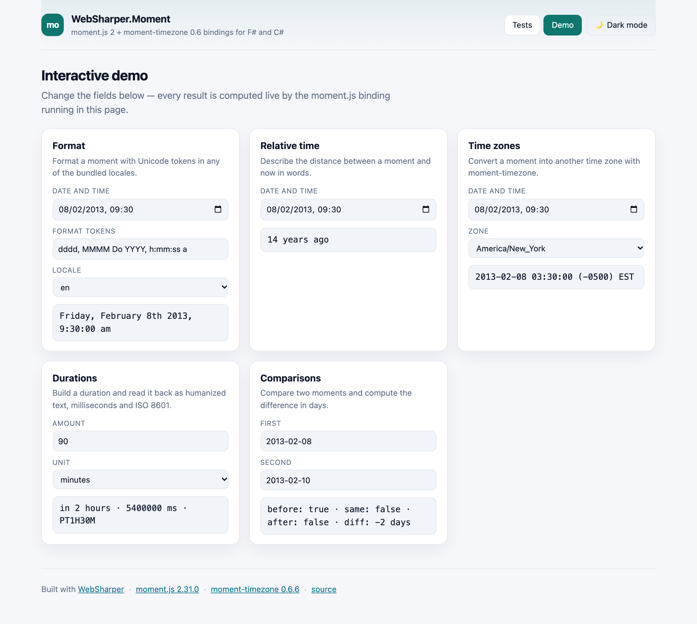

# WebSharper.Moment

[](https://www.nuget.org/packages/WebSharper.Moment)

WebSharper bindings for [moment.js](https://momentjs.com) 2 and
[moment-timezone](https://momentjs.com/timezone/) 0.6 — parsing, formatting,
arithmetic, durations, locales and time zones for F# and C# web apps.

The binding targets **moment.js 2.31.0** (`>= 2.31.0 < 3.0.0`) and
**moment-timezone 0.6.6** (`>= 0.6.6 < 1.0.0`), and is built for WebSharper 11
on .NET 11.

This repository contains:

| Project | Purpose |
| --- | --- |
| `WebSharper.Moment` | The binding: WIG definitions for `Moment`, `Duration`, `LocaleData`, `TimeZone` (`moment.tz`), `Zone`, `ParsingFlags`, `UnpackedBundle` and `HTML5ConstantFormats`. |
| `WebSharper.Moment.Sample` | A static SPA that runs an in-browser assertion suite and an interactive demo. |

## Live demos

**Try it live:** [Open the sample in your browser](https://dotnet-websharper.github.io/moment/)



The sample doubles as the binding's [test case](#running-the-test-case): it runs
52 assertions across the whole surface in the browser and reports pass/fail, and
it has an interactive demo for formatting, relative time, time zones, durations
and comparisons. It is light-themed by default and has a light/dark theme
switcher (persisted in `localStorage`).

- **Sample (this repository):** <https://dotnet-websharper.github.io/moment/>
- **Source repository:** <https://github.com/dotnet-websharper/moment>
- **WebSharper bindings:** <https://websharper.com/bindings>

## Features

- **Construction and parsing:** `new Moment(...)` for ISO strings, formats,
  timestamps, `Date`, arrays and objects; `Moment.Unix`, `Moment.Utc`,
  `Moment.ParseZone`, `Moment.Max`/`Moment.Min`, and the `IsMoment`/`IsDate`/
  `IsDuration` predicates.
- **Formatting:** `Format` with Unicode tokens, `ToISOString`, `ToJSON`,
  `ToArray`, `ToObject`, `ToDate`, `Unix`, `ValueOf`, and the
  `HTML5ConstantFormats` constants.
- **Arithmetic and getters:** `Add`/`Subtract` (numbers, units, `Duration` and
  objects), `StartOf`/`EndOf`, `Set`, and the full getter/setter family
  (`Year`, `Month`, `Date`, `Hour`, `Minute`, `Second`, `Millisecond`, `Day`,
  `Week`, `IsoWeek`, `Quarter`, `DayOfYear`, …).
- **Comparisons:** `IsBefore`, `IsAfter`, `IsSame`, `IsSameOrBefore`,
  `IsSameOrAfter`, `IsBetween`, `IsLeapYear`, `IsDST`, and `Diff`.
- **Relative time:** `FromNow`, `From`, `ToNow`, `To`, `Calendar`.
- **Durations:** `Duration` constructors, `Humanize`, the `As*` conversions,
  `Get`, `ToISOString`, `Clone` and `Locale`.
- **Locales:** `Moment.Locale`, `Moment.LocaleData`, `DefineLocale`,
  `UpdateLocale`, and the `LocaleData` accessors.
- **Time zones:** `Moment.Tz`, the instance `Tz`, `UtcOffset`, `ZoneAbbr`,
  `ZoneName`, and the `TimeZone` (`moment.tz`) namespace — `Names`, `Guess`,
  `Zone`, `Add`, `Link`, `Load`, `SetDefault`, `Unpack`, `UnpackBase60`.

## Installation

```bash
dotnet add package WebSharper.Moment
```

or, from Paket:

```
nuget WebSharper.Moment
```

The package targets `netstandard2.0` and works with any WebSharper 10 or 11
project. moment.js and moment-timezone are pulled from npm (`moment`,
`moment-timezone`), so the JS bundle step must resolve them (WebSharper's
SPA/esbuild build does this automatically).

## Usage

All types live in the `WebSharper.Moment` namespace.

```fsharp
open WebSharper
open WebSharper.JavaScript
open WebSharper.Moment

[<JavaScript>]
module Demo =
    let run () =
        // Construction and formatting
        let now = new Moment()
        now.Format("YYYY-MM-DD HH:mm")                 // e.g. "2026-11-11 09:30"

        // Arithmetic
        now.Add(1, "days").StartOf("day").Format("LLL")

        // Durations
        let d = Duration(2, "hours")
        d.Humanize()                                   // "2 hours"
        d.AsMinutes()                                  // 120

        // Comparisons
        now.IsBefore(now.Clone().Add(1, "days"))       // true
        now.Diff(now.Clone().Subtract(1, "days"), "hours") // 24

        // Time zones (moment-timezone)
        now.Tz("America/New_York").Format("LLL z")     // "… EST"
        TimeZone.Names().Length                        // number of bundled zones
        TimeZone.Guess()                               // the browser's zone

        // Unix timestamps
        Moment.Unix(1360315826).ToUtc().Format("YYYY-MM-DD")
```

## Notes on the API

- **The package is npm-based.** The binding imports the default export of
  `moment-timezone` (`import moment from "moment-timezone"`); nothing is fetched
  from a CDN. Add `moment` and `moment-timezone` to your front-end dependencies
  (WebSharper registers them as `NpmDependencies` entries).
- **Locales are opt-in.** moment ships its locale data as separate modules, so
  register the ones you need with a side-effect import before using them, e.g.
  `import "moment/locale/fr"`. The sample does this in `entry.mjs`.
- **`Moment.ISO_8601` is the parsing sentinel**, not a format string. Use a
  format such as `"YYYY-MM-DDTHH:mm:ssZ"` with `Format`.
- **The instance `utc()` is exposed as `ToUtc()`** to avoid clashing with the
  static `Moment.Utc(...)`.
- **`TimeZone` is the `moment.tz` namespace** and `Zone` is `moment.tz.Zone`.
  `TimeZone.Zone(name).UtcOffset(ms)` returns the zone's offset in minutes
  (positive west of UTC, matching moment-timezone).
- **moment-timezone 0.6 removed the data-packing helpers** (`pack`,
  `packBase60`, `createLinks`, `filterYears`, `filterLinkPack`); the binding no
  longer exposes them.
- **`Duration` constructors map to `moment.duration(...)`**, so
  `Duration(90, "minutes")` is `moment.duration(90, "minutes")`.

## Running the test case

The sample is a static SPA. Building it runs `npm install` and esbuild and emits
`dist/` at the repository root:

```bash
dotnet build WebSharper.Moment.Sample/WebSharper.Moment.Sample.fsproj -c Release
dotnet serve -d dist -p 8080
```

`dotnet serve` comes from the [`dotnet-serve`](https://github.com/dotnet-serve/dotnet-serve)
tool; install it once with `dotnet tool install -g dotnet-serve` (or use
`dotnet tool run dotnet-serve` with a local tool manifest).

Open <http://localhost:8080/>. The **Tests** page runs every assertion in the
browser and shows the expected and actual values; the **Demo** page lets you
exercise formatting, relative time, time zones, durations and comparisons live.
The theme toggle switches between the light (default) and dark palettes.

## Build from source

### Prerequisites

- [.NET SDK 11](https://dotnet.microsoft.com/download) (the WebSharper 11
  compiler needs the .NET 11 runtime).
- [Node.js](https://nodejs.org/) (for the sample's esbuild step).
- [Paket](https://fsprojects.github.io/Paket/) as a local dotnet tool (configured
  in `.config/dotnet-tools.json`).

### Restore and build

```bash
dotnet tool restore
dotnet paket restore
dotnet build WebSharper.Moment.sln -c Release
```

The binding targets `netstandard2.0`; the sample is a static bundle.

### Pack the NuGet package

After a Release build (so the assembly exists in `bin/Release/netstandard2.0`):

```bash
dotnet paket pack ./nuget
```

## Deployment

Pushing to `main` triggers `.github/workflows/ghpages.yml`, which builds the
sample in Release and publishes `dist/` to the `gh-pages` branch via GitHub
Pages.

## Repository layout

```
WebSharper.Moment/              # the binding (WIG definitions)
  Definition.fs
WebSharper.Moment.Sample/       # static SPA demo / test case
  Client.fs
  index.html
  site.css
  entry.mjs                     # registers the moment locales, then the app
  esbuild.config.mjs
  wsconfig.json
docs/
  sample.png                    # screenshot of the running sample
  WebSharperMoment.md           # binding notes
nuget/                          # Paket pack template
.github/workflows/ghpages.yml   # build + deploy the sample
```

## License

Apache 2.0 — see [LICENSE.md](LICENSE.md).
